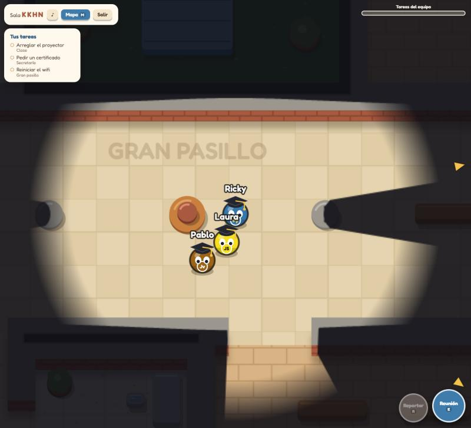
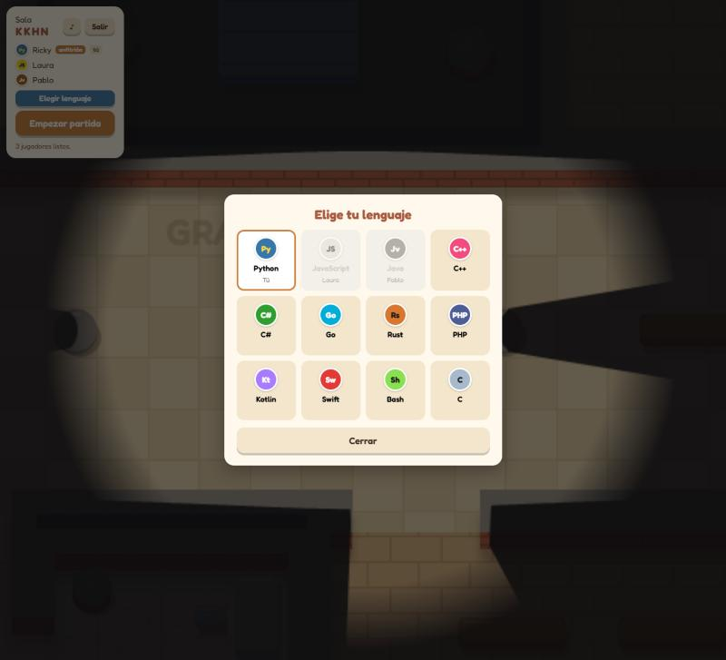
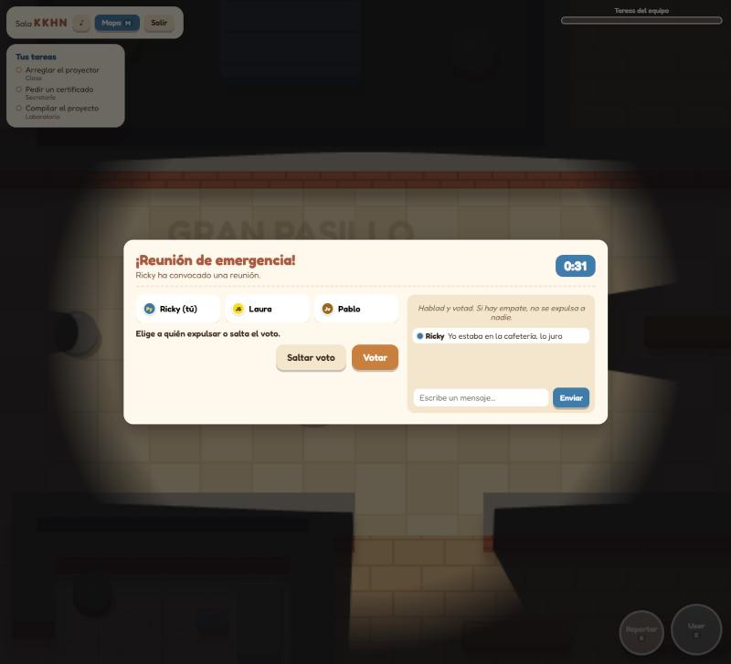
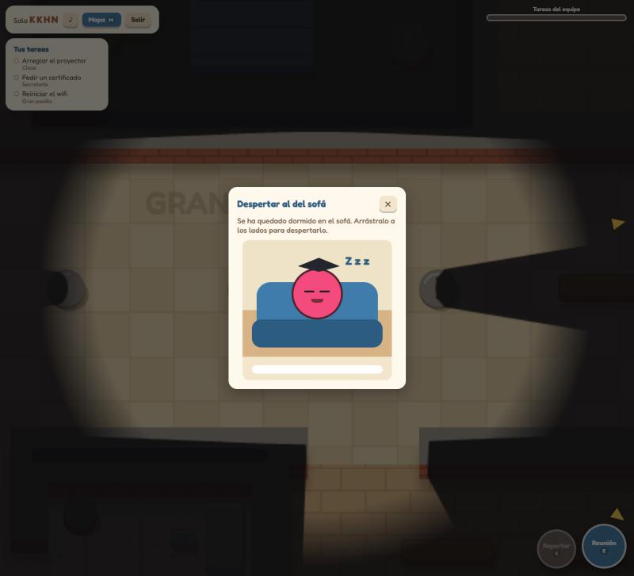
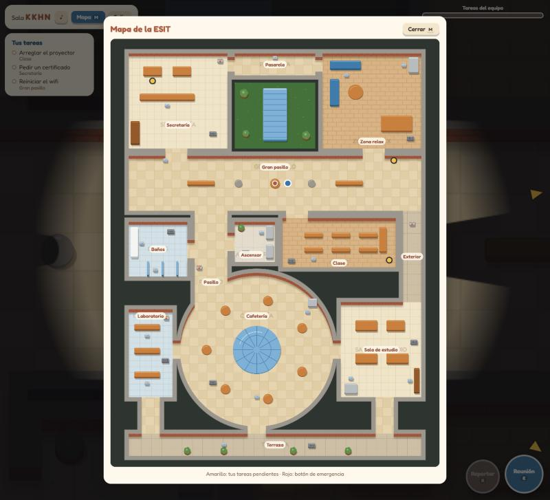
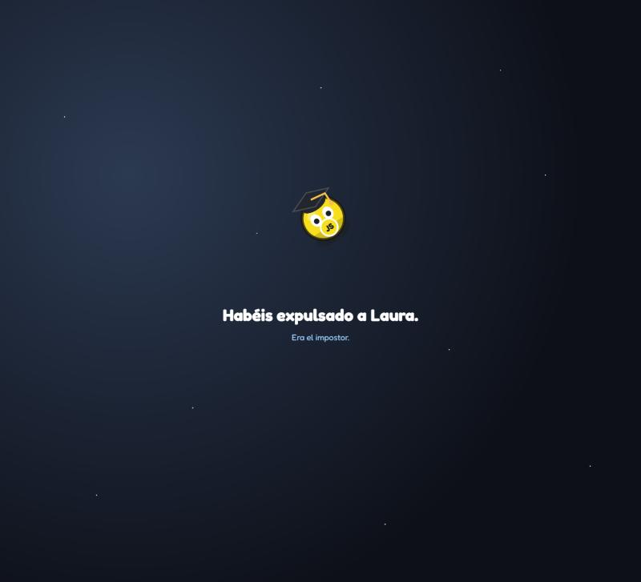
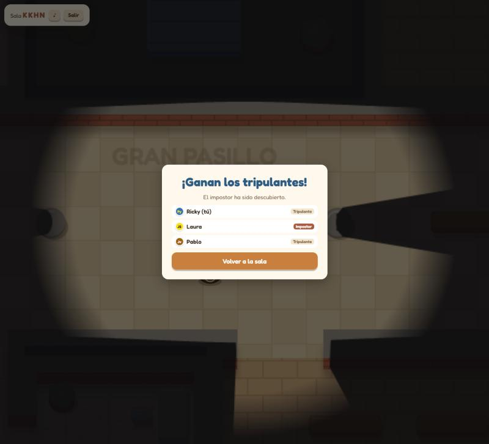

# Impostor en la ESIT

Juego multijugador por navegador tipo "impostor", ambientado en la Escuela
Superior de Ingeniería y Tecnología (Universidad de La Laguna). Cada jugador
es un lenguaje de programación con birrete, y uno de ellos es el impostor
que no deja entregar las prácticas.

Se juega online desde cualquier red (casa, datos móviles, wifi de la
facultad), en el ordenador o en el móvil, sin instalar nada.



| | |
| --- | --- |
|  |  |
|  |  |
|  |  |

## Cómo se juega

- **De 3 a 10 jugadores.** Uno crea la sala y pasa el código de 4 letras.
  Cada uno elige su lenguaje (Python, JavaScript, Java, C++, Rust, Go…) y el
  anfitrión pulsa **Empezar partida**.
- **Hay un impostor.** El resto son tripulantes y tienen 3 tareas repartidas
  por la facultad. Las marcan flechas amarillas y salen en el mapa (tecla M).
  Cada tarea es un minijuego: despertar al que duerme en el sofá, fotocopiar
  apuntes, conectar los cables del proyector, pedir un barraquito, compilar
  sin errores… Si el equipo termina todas, ganan los tripulantes.
- **El impostor** tiene tareas falsas para disimular y además puede:
  - **Matar** a un tripulante cercano (cada 15 s). Deja un cuerpo.
  - **Moverse por trampillas** conectadas: baños ↔ laboratorio,
    secretaría ↔ cafetería, zona relax ↔ sala de estudio y
    ascensor ↔ clase ↔ terraza.
  - **Sabotear** (cada 30 s): tirar el wifi (nadie ve sus tareas), apagar las
    luces (los tripulantes casi no ven) o provocar una **fuga de radón**:
    hay que cerrar las válvulas del Laboratorio y de Secretaría antes de
    45 s o gana el impostor.
- **Reuniones.** Quien encuentre un cuerpo lo reporta, o cualquiera pulsa el
  botón de emergencia del gran pasillo (una vez por partida). Hay 40 s para
  hablar por chat y votar; el más votado sale expulsado (con empate, nadie).
- **Visión limitada.** Solo ves lo que tienes alrededor y las paredes y los
  muebles altos tapan la vista. El impostor ve un poco más lejos.
- **Los muertos** son fantasmas: atraviesan paredes, lo ven todo y, si eran
  tripulantes, pueden seguir haciendo tareas.
- **Ganan los tripulantes** si expulsan al impostor o terminan las tareas.
  **Gana el impostor** si quedan tantos impostores como tripulantes o si el
  radón no se cierra a tiempo.

## Controles

| Acción | Teclado | Móvil |
| --- | --- | --- |
| Moverse | WASD o flechas | Joystick (toca la mitad izquierda de la pantalla) |
| Usar: tarea, botón de emergencia, trampilla o arreglar un sabotaje | E | **Usar** |
| Matar (impostor) | Q | **Matar** |
| Reportar un cuerpo | R | **Reportar** |
| Sabotear (impostor) | F | **Sabotear** |
| Ver el mapa | M | **Mapa** |
| Cerrar un minijuego | Esc | ✕ |

El botón ♪ de arriba activa o silencia el sonido.

## Jugar online (desplegar en Render)

El servidor es un único proceso de Node que sirve la web y los WebSockets en
el mismo puerto, así que se puede desplegar gratis en
[Render](https://render.com).

1. **Sube el proyecto a GitHub.** Crea un repositorio vacío en
   https://github.com/new (sin README ni .gitignore) y, en la carpeta del
   proyecto:

   ```bash
   git remote add origin https://github.com/TU_USUARIO/impostor-facultad.git
   git push -u origin main
   ```

2. **Crea el servicio en Render.** Entra en https://dashboard.render.com con
   tu cuenta de GitHub → **New** → **Web Service** → elige el repositorio y
   rellena:
   - **Language:** Node
   - **Branch:** main
   - **Build Command:** `npm install`
   - **Start Command:** `npm start`
   - **Instance Type:** Free

   (Alternativa: **New → Blueprint** usa el archivo `render.yaml` del
   repositorio y lo configura todo solo.)

3. **Espera al despliegue** (un par de minutos) hasta que salga **Live**.
   Render te da una URL del tipo `https://impostor-facultad.onrender.com`.

4. **Comprueba que vive:** `https://TU-URL.onrender.com/health` debe
   responder `ok`. Después abre la URL principal y crea una sala.

5. **Pasa el enlace a tus amigos.** Cada `git push` vuelve a desplegar solo.

### El plan gratuito se duerme

Si nadie lo usa durante unos 15 minutos, Render apaga el servidor. La
siguiente visita lo despierta, pero tarda entre 30 s y un minuto. **Abre el
enlace (o `/health`) unos minutos antes de jugar.** Al dormirse se pierden
las salas abiertas, nada más.

### Si se corta la conexión

Si a alguien se le bloquea la pantalla o cambia de wifi a datos, el juego
muestra "Reconectando…" y vuelve solo. Tiene 30 segundos para volver con su
mismo personaje, rol y tareas; pasado ese tiempo sale de la sala. Recargar la
página también recupera la partida (en la misma pestaña).

### Plan B: sin internet

- **Misma wifi:** ejecuta `npm start` en un portátil y abre en los móviles la
  IP que imprime el servidor al arrancar (`http://192.168.x.x:3000`). Algunas
  redes, como la de la universidad, aíslan a los dispositivos entre sí; en
  ese caso usa la opción siguiente.
- **Hotspot del móvil:** activa la zona wifi en un móvil, conecta a ella el
  portátil y los demás móviles, y usa la IP que imprime el servidor.
- Si Windows pregunta por el firewall al arrancar Node, permite el acceso en
  redes privadas.

## Ejecutar en local

Necesitas [Node.js](https://nodejs.org) 18 o superior.

```bash
npm install
npm start
```

Abre http://localhost:3000, crea una sala y únete desde otras **ventanas**
(no pestañas: el navegador pausa las pestañas que no se ven). Para
desarrollo, `npm run dev` reinicia el servidor al cambiar archivos.

Hacen falta 3 jugadores para empezar. Para probar con dos ventanas, baja
`MIN_PLAYERS` en `server/config.js`.

## Tests

```bash
npm test
```

Usan `node:test` y clientes WebSocket simulados. Comprueban el mapa (todas
las salas, tareas, trampillas y puntos de sabotaje se pueden alcanzar), la
línea de visión, las reglas (matar, tareas, votaciones, sabotajes, botón de
emergencia, victorias), la reconexión y partidas completas por WebSocket.

## Cómo está hecho

- **Servidor:** Node + [ws](https://github.com/websockets/ws). Un solo
  puerto sirve la web, `/health` y los WebSockets.
- **Cliente:** canvas 2D y módulos ES nativos, sin frameworks ni bundler.
  Todo se dibuja por código (personajes, mapa, minijuegos y sonidos), sin
  imágenes ni logos.
- **Red:** el cliente manda su posición 20 veces por segundo y el servidor
  reparte el estado al mismo ritmo; los demás jugadores se interpolan para
  que se muevan suaves. El servidor valida todo (velocidad, paredes,
  distancias y tiempos) y nunca envía los roles a quien no le toca.
- **Reglas puras:** `server/game.js` y el resto de módulos de reglas no
  dependen de Node ni de `ws`: reciben el estado y un mensaje y devuelven los
  mensajes a enviar. Así se podrían llevar a Cloudflare Workers + Durable
  Objects sin tocarlas.

```
server/
  index.js       arranque: http + WebSocket, ping, /health
  rooms.js       salas, sockets, tokens y reconexión
  messages.js    validación de los mensajes del cliente
  config.js      constantes (tiempos, rangos, jugadores mínimos)
  game.js        jugadores, movimiento y reparto de estado   ┐
  lobby.js       lenguajes, empezar y volver a la sala         │
  actions.js     matar, reportar, tareas y botón de emergencia │ lógica pura
  meeting.js     reuniones, chat y votación                    │
  sabotage.js    sabotajes                                     │
  vents.js       trampillas                                    │
  victory.js     condiciones de victoria                       │
  info.js        consultas y mensajes comunes                  ┘
client/
  index.html, css/
  js/            main (bucle), network, session, input, state, players,
                 map + places (datos del mapa), render, mapview, vision,
                 furniture, characters, markers, ui, lobby, hud, actions,
                 meeting, endscreen, minimap, ventui, sabotageui, effects,
                 sound, match
  js/minigames/  un minijuego por tarea, agrupados por tipo
shared/
  constants.js   lo que usan servidor y cliente (lenguajes, tareas, rangos)
tests/           tests con node:test y clientes simulados
docs/            capturas de este README
```

El mapa vive en `client/js/map.js` (salas, puertas y muebles como
rectángulos y círculos) y `client/js/places.js` (estaciones de tareas,
trampillas, botón y puntos de sabotaje): se puede cambiar sin tocar la lógica.

## Licencia

[MIT](LICENSE). Proyecto hecho por diversión; no está afiliado a la
Universidad de La Laguna.
